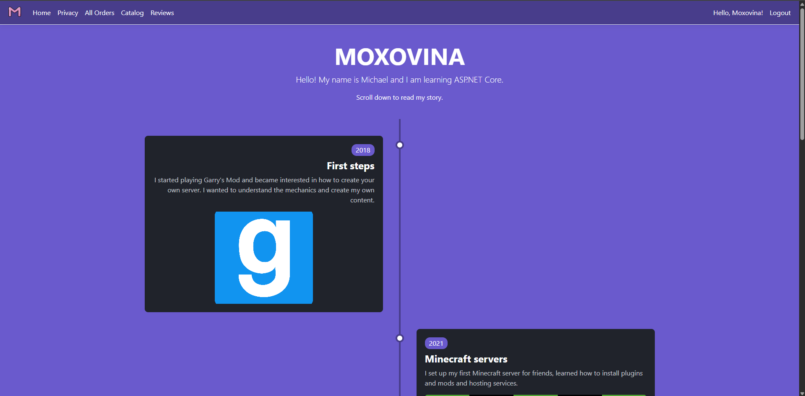
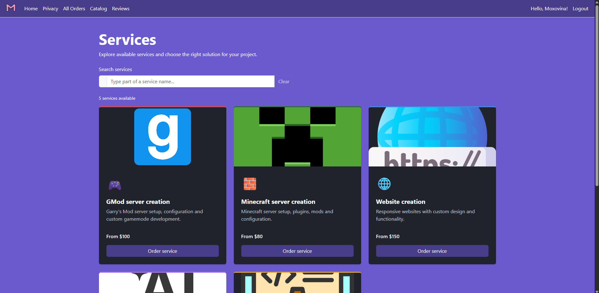
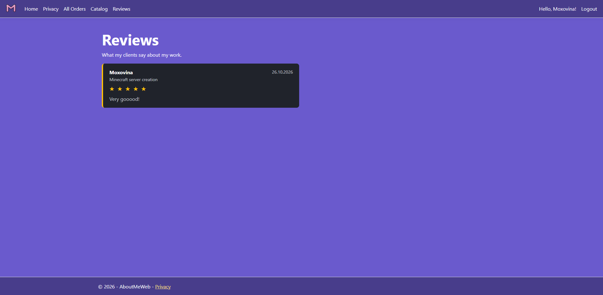

# AboutMeWeb
This is my personal portfolio website. Here you can learn about me, order a service (GMod/Minecraft server, website, AI integration, custom application) and leave a review.
This is my course project for ASP.NET Fundamentals at SoftUni.

## Features
- Home page – my biography and the story of how I developed as a person and as a developer.
- Services catalog – a catalog of my services with search and the option to order.
- Ordering a service – an order page where you choose the service and its tier, and the price is calculated automatically.
- All orders – a list of all orders I have received.
- Reviews – reviews with star ratings from clients who ordered a service. You can create, edit and delete your reviews from your profile (CRUD).
- Accounts – registration, login, profile page, username and email.
- Privacy page

## Technologies
- ASP.NET Core MVC (.NET 10)
- Entity Framework Core 10 + SQL Server (SQL Express)
- ASP.NET Core Identity
- Razor views, layout, partial views, sections
- Bootstrap 5, jQuery Validation (client-side validation)

## Project structure
- `Controllers/` – MVC controllers: `HomeController` (home and privacy pages), `ServicesController` (catalog and ordering), `ReviewsController` (reviews CRUD).
- `Models/` – entity models (`Service`, `Review`) and view models for forms and pages.
- `Services/` – business logic layer. Controllers use these services through interfaces (Dependency Injection), so they don't work with the database directly. `ServicePricing` calculates prices and titles.
- `Data/` – `ApplicationDbContext`, `ApplicationUser` (the user account).
- `Data/Configurations/` – Fluent API configurations for relations between tables.
- `Views/` – Razor views, shared layout and partial views (`_LoginPartial`, `_Stars`, `_BioItem`, `_ReviewForm`).
- `Areas/Identity/` – scaffolded ASP.NET Core Identity pages (Register, Login, Logout, Profile).
- `Common/ValidationConstants.cs` – all min/max values for validation in one place.

## Database
- `ApplicationUser` – a registered user (extends `IdentityUser`). Has a username, email and password. One user can have many orders.
- `Service` (order) – a service ordered by a user: type, tier, description and price. Belongs to one user. If the user account is deleted, the order stays, but without an owner.
- `Review` – a review for an order: rating from 1 to 5 stars and a comment. Every order can have only one review. If the order is deleted, its review is deleted too.

Relations:
- `ApplicationUser` 1 → many `Service`
- `Service` 1 → 0..1 `Review`

## Getting started

### Requirements
- .NET 10 SDK
- SQL Server Express (instance `.\SQLEXPRESS`)
- Visual Studio 2026 (or the `dotnet ef` tool)

### Connection string
The default connection string is in `AboutMeWeb/appsettings.json`:

```
Server=.\SQLEXPRESS;Database=AboutMeWebDb;Trusted_Connection=True;TrustServerCertificate=True;MultipleActiveResultSets=true
```
No other environment variables or secrets are needed.

### Run
1. Clone the repository
   ```
   git clone https://github.com/Moxovina929/AboutMeWeb.git
   ```
2. Open `AboutMeWeb.slnx` in Visual Studio
3. Apply migrations (Package Manager Console):
   ```
   Update-Database 
   ```
   or from the terminal in the `AboutMeWeb` folder:
   
   ```
   dotnet tool update --global dotnet-ef
   dotnet ef database update
   ```
4. Run the project (F5) and open `https://localhost:7182`

### Test account
Register a new account on the Register page.
Password rules: at least 6 characters, at least one digit and one lowercase letter.

## Screenshots
### Home


### Catalog


### Reviews


## Author
Michael / Moxovina - https://github.com/Moxovina929